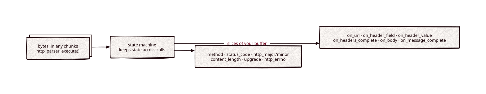

# http-parser

Part of [Kronuz C++ Libraries](https://github.com/Kronuz/cpp-libraries), a collection of small, reusable C++ libraries.

[](https://github.com/Kronuz/http-parser/actions/workflows/ci.yml)
[](LICENSE)


A streaming HTTP/1.0 and HTTP/1.1 parser for C++20: feed it bytes in whatever
chunks they arrive, and it calls you back with the method, URL, headers, and
body as slices of your own buffer. The Joyent/Node.js `http_parser`, with
reflective enums and Xapiand's extra verbs.



## ✨ Highlights

- **Streaming.** A request split across any number of calls parses the same as
  one buffer, byte by byte included.
- **Zero copy, zero allocation.** Callbacks receive pointers into your input.
- **Complete HTTP/1.x framing.** `Content-Length` and chunked bodies, keep-alive,
  upgrades, and a typed error code for malformed input.
- **Reflective enums.** Methods, statuses, and errors are
  [enum-reflection](https://github.com/Kronuz/enum-reflection) enums, so they
  print and parse by name.
- **More verbs.** `SEARCH`, `COMMIT`, `UPDATE`, and others alongside the standard
  methods.

## 📦 Installation

Requires a C++20 compiler and CMake 3.14 or newer; it fetches enum-reflection.
It compiles one source file, `http_parser.cc`. CI builds it on Linux (x86_64,
arm64), macOS (arm64, x86_64), and FreeBSD, plus ASan, UBSan, and TSan builds.

```cmake
include(FetchContent)
FetchContent_Declare(http_parser
  GIT_REPOSITORY https://github.com/Kronuz/http-parser.git
  GIT_TAG        main)
FetchContent_MakeAvailable(http_parser)

target_link_libraries(my_app PRIVATE http_parser::http_parser)
```

## 🚀 Quick start

```cpp
#include "http_parser.h"

#include <cstring>
#include <string>

int main() {
	std::string url;
	http_parser_settings settings;
	http_parser_settings_init(&settings);
	settings.on_url = [](http_parser* p, const char* at, size_t n) {
		static_cast<std::string*>(p->data)->append(at, n);   // may arrive in pieces
		return 0;
	};

	http_parser parser;
	http_parser_init(&parser, HTTP_REQUEST);
	parser.data = &url;

	const char* req = "GET /search?q=x HTTP/1.1\r\nHost: example.com\r\n\r\n";
	http_parser_execute(&parser, &settings, req, std::strlen(req));
	// parser.method == HTTP_GET, url == "/search?q=x", HTTP_PARSER_ERRNO(&parser) == HPE_OK
}
```

[`examples/demo.cc`](examples/demo.cc) parses a POST, re-parses it byte by byte,
and shows the error for a malformed request.

Clients needing repeated equal Content-Length compatibility can call `http_parser_set_allow_equal_content_length(&parser, 1)` after initialization. Default duplicate rejection stays unchanged; conflicts and chunked/length ambiguity remain errors. The added state requires rebuilding consumers and the library together. See [the API contract](docs/API.md).

## 🎯 When to use it

- ✅ An HTTP/1.x server or client loop that reads from sockets in arbitrary
  chunks.
- ❌ HTTP/2 or HTTP/3: it parses HTTP/1.x only.
- ❌ A new project with no ties to this API: upstream Node.js has replaced
  `http_parser` with [llhttp](https://github.com/nodejs/llhttp).

## 📚 Documentation

- [docs/API.md](docs/API.md): the entry points, the parser fields, and the
  callback rules.
- [ARCHITECTURE.md](ARCHITECTURE.md): the state machine and Xapiand's additions.
- [AGENTS.md](AGENTS.md): repository map, invariants, and traps.

## 🛠️ Building and testing

```sh
cmake -B build && cmake --build build && ctest --test-dir build
./build/http_parser_demo
```

## 🤝 Contributing

Issues and pull requests are welcome. Read [AGENTS.md](AGENTS.md) first. CI must
pass on every platform.

## 📄 License

MIT. Based on NGINX's parser (Copyright Igor Sysoev), with changes Copyright
Joyent, Inc. and other Node contributors; Xapiand's additions Copyright (c)
2015-2019 Dubalu LLC. See [LICENSE](LICENSE).
